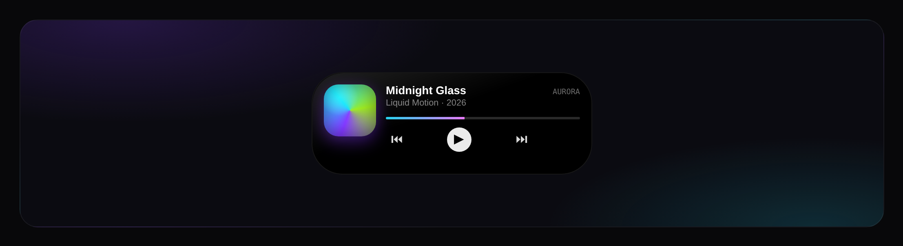
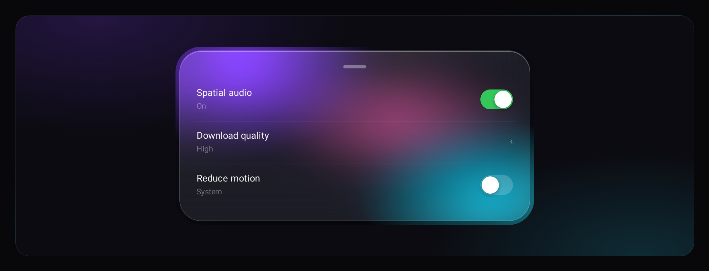
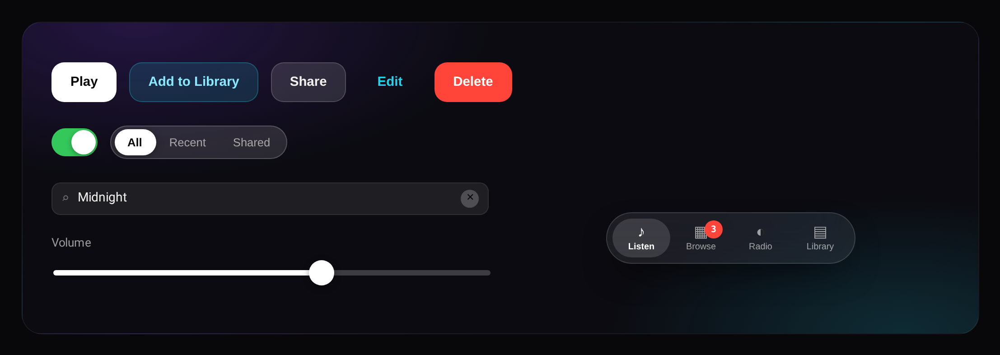
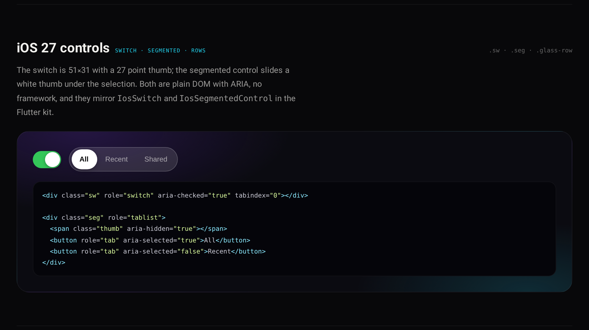
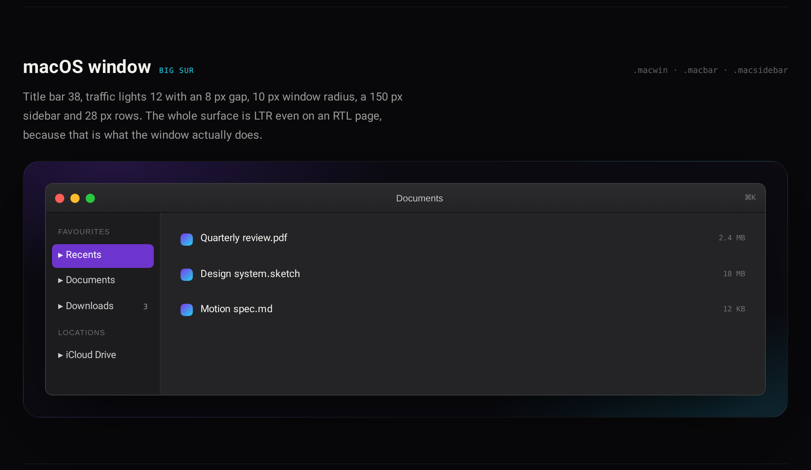

# Apple UI Components

یک کیت کامپوننت برای ساختن اپ‌هایی که حس‌وحال iOS و macOS را دارند — هم روی وب، هم روی فلاتر. بدون وابستگی، بدون مرحله‌ی بیلد.

**ایده‌ی اصلی ساده است:** یک بار طراحی می‌کنی، دو جا جواب می‌گیری. وب با HTML/CSS و دو ماژول جاوااسکریپت، فلاتر با یک پکیج آماده. هر دو طرف از یک مقیاس توکن — همان رنگ‌ها، همان شعاع‌ها، همان زمان‌های حرکت — استفاده می‌کنند، پس نمونه‌ی وب و بیلد نیتیو کم‌کم از هم دور نمی‌شوند.




---

## چی داخلش است؟

### وب — `web/components/`

| کامپوننت | کلاس / API | توضیح |
|---|---|---|
| Dynamic Island با ۵ حالت | `.island` + `island.js` | idle ،compact ،expanded ،notif ،call — فقط وب |
| Liquid Glass | `.glass-stage` / `.glass-panel` | بلور ۲۸، تینت، خط مویی |
| سوییچ iOS | `.sw` | ‏۵۱×۳۱، با `bootControls()` |
| Segmented Control | `.seg` | شستی سفید که زیر انتخاب سر می‌خورد |
| ردیف‌های تنظیمات | `.glass-row` | ردیف ۵۲ پیکسلی داخل پنل شیشه‌ای |
| دکمه‌ها | `.btn` — filled / tinted / plain / destructive | جدید در v1.1 |
| جست‌وجو | `.search` | فیلد ۳۶ پیکسلی با دکمه‌ی پاک‌کردن |
| اسلایدر | `input.slider` | شستی ۲۸ پیکسلی، پرشوندگی با `--fill` |
| تب‌بار شناور | `.tabbar` | کپسول شیشه‌ای ۵۶ پیکسلی + بج |
| بج و توست | `.badge` / `.toast` | بج عددی و اعلان پایین صفحه |
| نوار ناوبری iOS | `.iosnav` | تایتل بزرگ ۳۴ |
| پنجره‌ی macOS | `.macwin` | نوار عنوان ۳۸، چراغ‌های ۱۲، سایدبار ۱۵۰ |
| ابزارهای حرکت | `[data-reveal]` و کمک‌کننده‌ها | فقط `transform` و `opacity` |

### فلاتر — `flutter/apple_ui_kit/`

۲۱ اکسپورت، شامل `IosGlass` ،`IosSwitch` ،`IosSheet` ،`IosNavBar` ،`IosTabBar` ،`MacWindow` ،`MacSidebar` ،`MacSlider` و بقیه — با یک صفحه‌ی نمونه و ۱۴ تست ویجتی. جزئیات کامل در [`flutter/apple_ui_kit/README.md`](flutter/apple_ui_kit/README.md) است.





---

## شروع سریع — وب

سه فایل CSS را لینک کن و دو تابع را صدا بزن:

```html
<link rel="stylesheet" href="web/components/fonts.css">
<link rel="stylesheet" href="web/components/tokens.css">
<link rel="stylesheet" href="web/components/components.css">

<div class="island" data-island data-state="idle" role="button" tabindex="0" aria-label="Now playing">
  <span class="layer" data-for="idle"><i class="dot"></i></span>
  <span class="layer" data-for="expanded">…</span>
</div>

<script type="module">
  import { boot } from './web/components/island.js';
  import { bootControls } from './web/components/controls.js';

  boot();          // همه‌ی جزیره‌ها را راه می‌اندازد
  bootControls();  // سوییچ، سگمنتد، جست‌وجو، اسلایدر و توست را
</script>
```

**نکته‌ی مهم:** صفحه را روی یک سرور محلی باز کن، نه با دابل‌کلیک روی فایل. ماژول‌های جاوااسکریپت با `file://` بالا نمی‌آیند:

```bash
python3 -m http.server 8000
# بعد برو روی http://localhost:8000/web/showcase.html
```

دموی همه‌ی کامپوننت‌ها همان `web/showcase.html` است — کنار هر کامپوننت، مارک‌آپ و کد استفاده‌اش نوشته شده. کاتالوگ کامل با اسکرین‌شات در [`docs/components.md`](docs/components.md) است.

### جزیره را چطور کنترل کنم؟

```js
const island = new DynamicIsland(el);

island.set('expanded');  // idle | compact | expanded | notif | call
island.cycle();          // یک دور می‌چرخد: compact → expanded → idle
island.on('change', (state) => console.log(state));  // هر وقت عوض شد خبر می‌دهد
island.destroy();        // وقتی از صفحه برداشتی‌اش، این را هم صدا بزن
```

اگر دو جزیره داشتی و خواستی هم‌زمان حرکت کنند، به هر دو یک `data-island-group` یکسان بده.

### چند مثال کوتاه

```html
<!-- دکمه‌ها -->
<button class="btn btn-filled">Play</button>
<button class="btn btn-tinted">Add to Library</button>
<button class="btn btn-destructive">Delete</button>

<!-- جست‌وجو -->
<div class="search">
  <span class="s-ico">⌕</span>
  <input type="search" placeholder="Search…">
  <button class="s-clear" aria-label="Clear search">✕</button>
</div>

<!-- اسلایدر -->
<input type="range" class="slider" min="0" max="100" value="62">

<!-- توست: یک المان در صفحه، هر دکمه‌ای با data-toast-show آن را نشان می‌دهد -->
<div class="toast" data-toast role="status">
  <span class="t-ico">✦</span><span data-toast-text></span>
</div>
<button data-toast-show data-toast-message="Added to your library ✦">Save</button>
```

---

## شروع سریع — فلاتر

```yaml
dependencies:
  apple_ui_kit:
    path: ../flutter/apple_ui_kit
```

```dart
IosGlass(
  child: IosListSection(
    header: 'Playback',
    children: <Widget>[
      IosListTile(
        title: 'Spatial audio',
        trailing: IosSwitch(
          value: spatial,
          onChanged: (bool v) => setState(() => spatial = v),
        ),
      ),
    ],
  ),
)
```

---

## می‌خواهی رنگ و اندازه‌ها را عوض کنی؟

همه‌چیز در یک فایل کوچک است: `web/components/tokens.css`. چند متغیر ساده، مثل `--r-card` یا `--r-sheet`. همان عددها در فلاتر هم هستند، با اسم‌های `AppleMetrics.cardRadius` و `AppleMetrics.sheetRadius`.

**قاعده‌اش این است:** عددی را که عوض کردی، در همان کامیت طرف دیگرش را هم عوض کن. وگرنه وب و فلاتر کم‌کم از هم دور می‌شوند و تا وقتی دو اسکرین‌شات را کنار هم نگذاری متوجه نمی‌شوی. جدول تطابق توکن‌ها در [`references/tokens.md`](references/tokens.md) است.

---

## پنج قانون که این کیت رویش ایستاده

1. **حرکت فقط با `transform` و `opacity`.** سرعت‌ها ۱۸۰ / ۲۶۰ / ۴۲۰ / ۵۶۰ میلی‌ثانیه است. تنها استثنا اندازه‌ی خود جزیره است که با `contain` مهار شده تا بقیه‌ی صفحه تکان نخورد.
2. **شیشه برای اینکه شیشه دیده شود، باید پشتش چیزی باشد.** پنل مات روی پس‌زمینه‌ی تیره، شبیه یک کارت خاکستری می‌شود؛ اول یک لایه رنگ بگذار پشتش، بعد بلور را کلیپ کن.
3. **هیچ کامپوننتی نمی‌داند در چه عرضی نشسته.** برای همین جزیره روی `--island-max` کلیمپ می‌شود، نه روی `100vw` تنها. همین یک چیز، بیشتر اسکرول افقی ناخواسته روی موبایل را حل می‌کند.
4. **متن فارسی هیچ‌وقت با فونت لاتین نوشته نمی‌شود.** فونت رابط (`--ui`) فقط لاتین است؛ فارسی می‌رود روی `--fa`، یعنی Vazirmatn.
5. **یک مقیاس توکن، دو پلتفرم.** تغییر `--r-card` بدون تغییر `AppleMetrics.cardRadius`، یک تغییر ناتمام است.

---

## ساختار ریپو

```
web/
  components/        # tokens.css, components.css, fonts.css, island.js, controls.js
  showcase.html      # دموی همه‌ی کامپوننت‌ها
flutter/apple_ui_kit/
  lib/               # ۲۱ اکسپورت: ios/ ،macos/ ،tokens/
  example/           # اپ نمایشی
  test/              # ۱۴ تست ویجتی
docs/
  components.md      # کاتالوگ کامپوننت‌ها با اسکرین‌شات
  screenshots/       # اسکرین‌شات‌های واقعی از کامپوننت‌های وب
references/          # island-spec ،glass ،motion ،tokens ،web ،flutter ،checklist
assets/fonts-licensed/  # فونت Vazirmatn (OFL 1.1)
scripts/fetch-fonts.py  # دانلود فونت‌های Fontshare (قابل بازتوزیع نیستند)
test/dom-check.mjs   # تست‌های DOM وب با jsdom
```

---

## امتحانش کن

```bash
npm install && npm test                                      # وب
cd flutter/apple_ui_kit && flutter analyze && flutter test   # فلاتر
```

آخرین باری که چک شد: تست‌های وب سبز، ۱۴ تست فلاتر سبز، و در کروم روی ۱۴۴۰ و ۳۹۰ پیکسل هیچ اسکرول افقی، هیچ خطای کنسول و هیچ فایل گم‌شده‌ای نبود. چک‌لیست ۱۸ موردی قبل از انتشار در [`references/checklist.md`](references/checklist.md) است.

---

## مشارکت

اگر کامپوننتی اضافه می‌کنی یا توکنی را عوض می‌کنی، [`CONTRIBUTING.md`](CONTRIBUTING.md) را بخوان: اول تست، بعد کامیت؛ وب و فلاتر همیشه با هم.

تغییرات هر نسخه در [`CHANGELOG.md`](CHANGELOG.md) است.

---

## لایسنس

- کد: MIT، راحت استفاده کن
- فونت Vazirmatn: OFL 1.1، داخل ریپو هست
- فونت‌های Fontshare: استفاده‌شان آزاد است ولی **نمی‌شود بازتوزیع کرد**؛ برای همین در ریپو نیستند و با `python3 scripts/fetch-fonts.py` خودت دانلودشان می‌کنی
- فونت SF Pro: اصلاً باندل نمی‌شود، فقط اسمش به‌عنوان fallback ذکر شده

هیچ فونت، آیکون یا تصویری از خود اپل در این ریپو نیست؛ فقط زبان طراحی‌اش الگو گرفته شده. جزئیات کامل در [`LICENSES.md`](LICENSES.md).

بیشتر بخواهی: پوشه‌ی [`references/`](references) — هر سند یک موضوع: جزیره، شیشه، حرکت، توکن‌ها، وب، فلاتر و یک چک‌لیست ۱۸ موردی برای قبل از انتشار.
