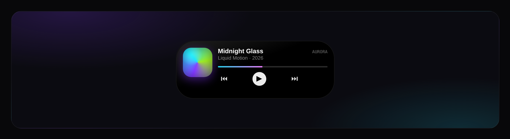
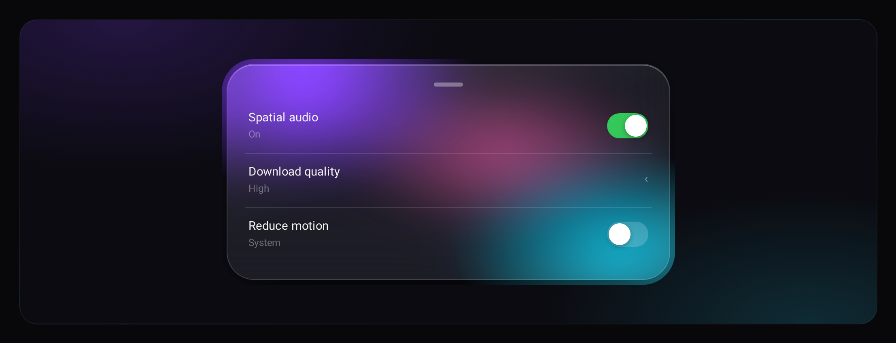
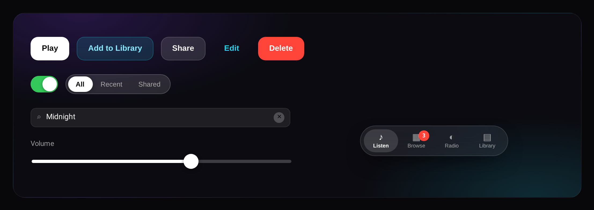
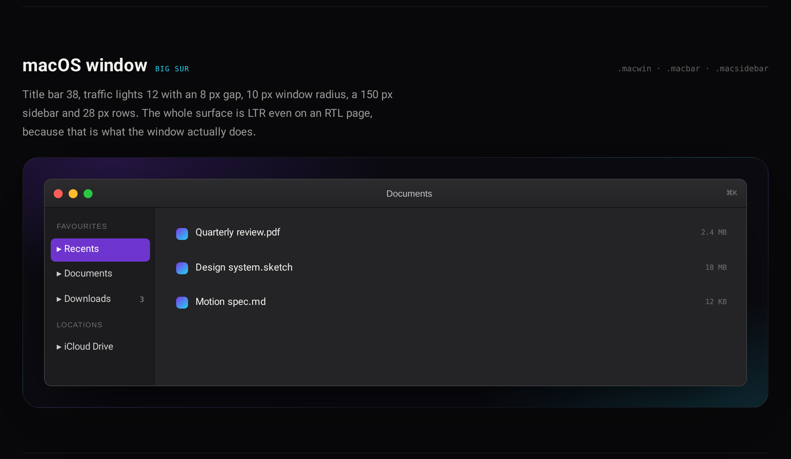

# Component catalogue

Every web component in the kit, with a real screenshot taken from
`web/showcase.html` (Chromium headless, 1280 px wide, served over HTTP).
Screenshots live in [`screenshots/`](screenshots/) and are re-taken whenever
a component's visuals change — a screenshot that no longer matches the code
is worse than no screenshot.

The Flutter twin of each component is named where one exists; the full
Flutter list is in [`../flutter/apple_ui_kit/README.md`](../flutter/apple_ui_kit/README.md).

## Dynamic Island



Five states in one black pill: `idle` (124×35), `compact` (216×38),
`expanded` (344×126), `notif` (322×62), `call` (300×56). Only the pill
animates width and height; the five layers cross-fade with opacity and
scale. Click it to cycle, or drive it from code:

```js
import { boot, DynamicIsland } from './web/components/island.js';
boot();
const island = new DynamicIsland(el);
island.set('expanded');
```

- **Files:** `web/components/components.css` (`.island`), `web/components/island.js`
- **Flutter twin:** none yet — web only
- **Accessibility:** `role="button"`, keyboard reachable, state buttons get `aria-pressed`

## Liquid Glass



A blurred, tinted pane with a hairline stroke and a diagonal sheen. The
colour bed behind it is part of the recipe: glass over pure black is just a
grey card. Blur is the `--glass-blur` token (28 px).

```html
<div class="glass-stage">
  <div class="glass-panel">
    <div class="grabber"></div>
    <div class="glass-row">…</div>
  </div>
</div>
```

- **Files:** `.glass-stage` / `.glass-panel` / `.glass-row` in `components.css`
- **Flutter twin:** `IosGlass`
- **Rule:** never stack glass on glass, and never put a blurred pane on every row of a long list.

## iOS controls — switch, segmented, buttons, search, slider



| Component | Markup | Size | Flutter twin |
|---|---|---|---|
| Switch | `<div class="sw" role="switch" aria-checked="true">` | 51×31, thumb 27 | `IosSwitch` |
| Segmented | `<div class="seg"><span class="thumb">…` | thumb measured from the labels | `IosSegmentedControl` |
| Buttons | `<button class="btn btn-filled">` | 44 tall; `.btn-sm` 34, `.btn-lg` 52 | `IosButton` |
| Search | `<div class="search"><input type="search">` | 36 tall | `IosSearchField` |
| Slider | `<input type="range" class="slider">` | thumb 28 | `MacSlider` |
| Tab bar | `<div class="tabbar"><button class="tabbar-item">` | 56 tall, floating capsule | `IosTabBar` |
| Badge | `<span class="badge">3</span>` | 20 tall | — |
| Toast | `<div class="toast" data-toast>` | bottom-centre, auto-hides | — |
| Nav bar | `<div class="iosnav"><h3 class="n-title">` | large title 34 | `IosNavBar` |

Button styles: `btn-filled` (white), `btn-tinted`, `btn` (default, translucent),
`btn-plain`, `btn-destructive`. macOS push buttons are `.macbtn`
(`.macbtn-primary`, `.macbtn-destructive`), 24 tall.

All of them are wired by one call — `bootControls()` in `controls.js` — which
also returns the handles (`switches`, `segmented`, `searches`, `sliders`,
`toasts`) if you need them by hand.

## macOS window



Title bar 38, traffic lights 12 with an 8 px gap, 10 px window radius, a
150 px sidebar and 28 px rows. The whole surface is LTR even on an RTL page,
because that is what the window actually does. Under 560 px the sidebar
becomes a swipeable strip.

- **Files:** `.macwin` / `.macbar` / `.macsidebar` / `.macrow` in `components.css`
- **Flutter twin:** `MacWindow` / `MacSidebar` / `MacListRow`

## Motion utilities

Reveal on scroll (`[data-reveal]` + `style="--d:2"`, 45 ms stagger), card
tilt, magnetic buttons, counters and a morphing blob — all transform-only,
all in `components.css` with the demo wiring in `showcase.html`. Reduced
motion (`prefers-reduced-motion: reduce`) keeps every state and drops the
movement.

## How the screenshots are taken

```bash
python3 -m http.server 8000
# Chromium headless against the showcase / shot pages, then crop to the section.
# See CONTRIBUTING.md — screenshots are part of the change, not an afterthought.
```
